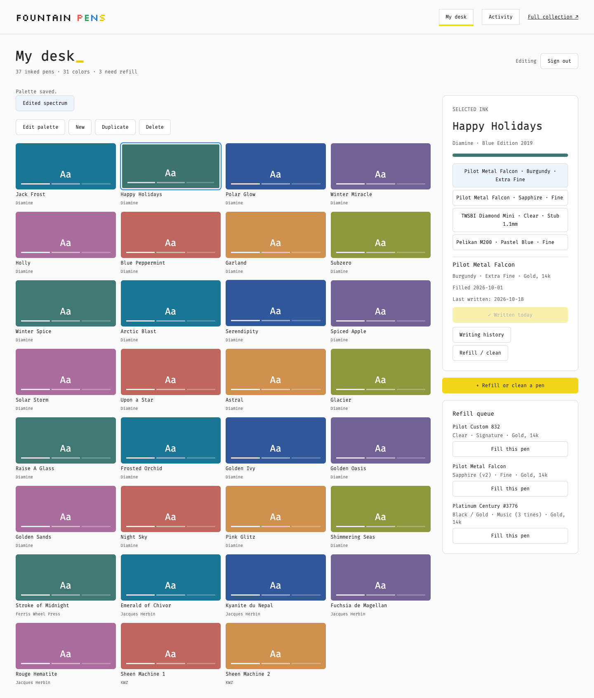
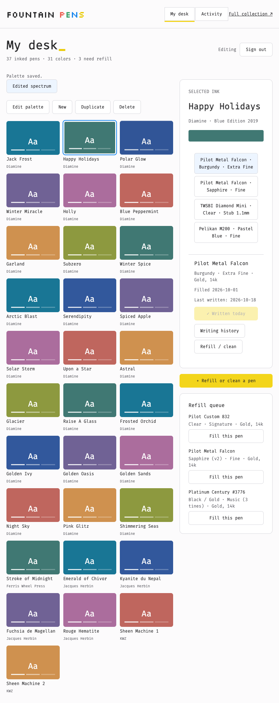
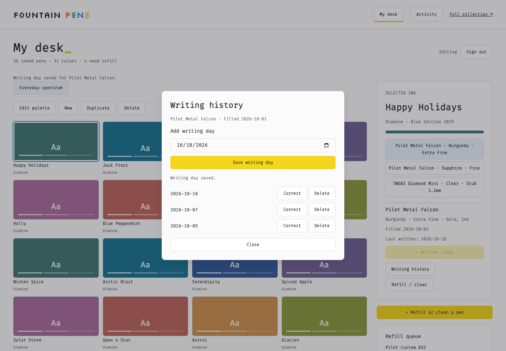

# Historical design notes

The connected Tamagui experiment documented below has been promoted to the sole homepage. The old app and lab entry have been removed; the descriptions of the original app and its Full collection link below are historical only. See the [current app documentation](../../README.md) and [homepage verification](../verification/homepage/README.md) for current scope.

# Tamagui connected desk experiment

A separate working desk at `/desk-lab.html`, now using the existing `useCollection`, Supabase adapter and owner capability. The original `/` app stays intact. No migrations, auth-policy changes, production writes, deployment changes, or merge.

## Try it

```sh
npm ci
# Configure the existing public browser variables from .env.example.
npm run dev
# open http://localhost:5173/desk-lab.html
```

Public visitors can browse saved palettes, current inks/pens, writing history, refill activity and the refill queue. Owner sign-in uses the existing Supabase password flow and database-approved `canEdit` capability. **Owner actions are connected writes**, not demo buttons; use synthetic interception for experiments.

- Saved named palettes: create, rename, duplicate, delete, drag/keyboard reorder, omit and restore. Dormant entries survive; newly current colors append through the existing reconciliation helper.
- Select an ink to use any of its current pens. Mixed refills retain every ink and residual-ink status.
- Wrote today records one day on that refill; history supports backdating, correcting and deleting. Last-written is derived from those records.
- Refill/cleaning editor: searchable pen and ink lists, needs-refill pens first, multiple inks, residual-ink flag, notes and the existing atomic queue behavior. Activity allows corrections to earlier refills and writing history.
- Pending saves prevent duplicate submissions; failures retain inputs. Auth state changes revoke owner controls until the server revalidates capability. Shared Tamagui dialogs trap focus and restore it on close.

## Current captures

[Public collection at desktop](connected-public.png) is an actual anonymous read: 37 current pens, 31 colors and four queued pens at capture. The saved palette intentionally omits colors. No production write requests were permitted.

The owner captures below use an intercepted backend built from the fixed importer inventory with **synthetic refills, palettes, colors and writing records**, including 36 active pens and 31 current colors. They demonstrate layout and writes without touching production.





## Reference-led visual direction

Linda supplied a Tamagui header screenshot and clarified: “the font style and the yellow/red/green/blue splash of colors on top of the plain computer terminal techy look (but still modern).” This supersedes the earlier Garden/Graphite proposals, which have been removed from the UI.

The supplied image shows a pixel-lettered logo, monospaced navigation, an almost-white surface, and small yellow/coral/green/blue accents. It is only a header, so it does not establish a preferred full-screen layout. The implementation uses **Silkscreen only for the wordmark**, **Fira Mono for the interface**, crisp light neutral surfaces, yellow primary actions, blue selection outlines, and small coral/green/blue brand accents. These are chosen approximations of the visible cues, not a claim to have identified the screenshot's exact fonts. Open-source font licenses are included in `public/fonts`.

Ink colors remain unchanged. The active refill stays beside the palette at desktop and 780px. Reduced radii and a horizontal utility header replace the prior soft sage rail, while the existing Tamagui component system and working flows are retained. No extra theme options or retro game styling were added.

The earlier `terminal-*.png` captures record the selected visual direction before service integration.

## What existed before this branch

Baseline: `d4fe6c72f3ddc866383cb91a16fd1c5c6f66ca8e` (PR #25), after writing-history PR #24 (`faf05b47b4d75f56325d4e0535c881bbfc826b10`).

React 19, Vite 6, React Router, dnd-kit, Supabase. `src/components/collection/Primitives.tsx` provides custom buttons/icons; `src/index.css` and `src/App.css` implement handwritten CSS tokens and component styles. No MUI, Tailwind, or third-party visual component system was installed. The old design uses Figtree + Bodoni Moda and warm paper/plum tokens.

### Linda's actual prior source

- [gpt-pet/app/package.json](https://github.com/yaylinda/gpt-pet/blob/main/app/package.json): Tamagui 1.79, Expo 49 / React 18, Tamagui Lucide icons and font packages.
- [gpt-pet/app/tamagui.config.ts](https://github.com/yaylinda/gpt-pet/blob/main/app/tamagui.config.ts): shared tokens/themes, dark default, Silkscreen heading/body, bouncy/lazy/quick springs.
- [TaskItem.tsx](https://github.com/yaylinda/gpt-pet/blob/main/app/src/modules/tasks/TaskItem.tsx): actual Button, SizableText and XStack use with rounded geometry, completion feedback and haptics. This is evidence of usage, not a claim that the exact font or native gestures are preferred for this desk.
- Other verified systems: NativeBase in `life-as-booleans-mobile` and `kitchen-sink`; NextUI + Tailwind in `gpt-games`; MUI in `pokemon-team-builder` and `pokopedia`.

Only targeted manifests/config/components were read. No unrelated repositories were cloned.

### History-backed lessons

| Recorded evidence                                                                                          | Design lesson / interpretation                                                                                                  |
| ---------------------------------------------------------------------------------------------------------- | ------------------------------------------------------------------------------------------------------------------------------- |
| `af25601` / PR #21: palette-first desk and inventory under Collection                                      | Recorded hierarchy: colors and current use lead; catalogs are secondary.                                                        |
| `5eef3b2`, `5d88cfe`: clarify palette drafts, group actions, simplify editing                              | Group palette tools and use one shared control vocabulary.                                                                      |
| `5617f80`, `f2d747a`: remove visible ordinals and redundant helper copy                                    | Recorded removal of those elements; avoid decorative numbers and permanent instructions.                                        |
| `1ac1c4b`, `a216494`, `6cf4610`, `cc7b104`: six columns, fluid swatches, separate identity/usage, outlines | These are iterations, not blanket preferences about ratios or borders. Keep recognizable ink identity and coherent proportions. |
| `bc9d803` / PR #23 removes substantial overview machinery                                                  | Inference: a focused desk earns more space than a dashboard of parallel summaries.                                              |
| `faf05b4` / PR #24 adds explicit refill writing days                                                       | Preserve refill identity and derive last-written from recorded days; never infer writing from fill date.                        |
| `d4fe6c7` / PR #25 brings palette and writing controls together                                            | Recorded proximity improvement; keep that relationship while changing visual language.                                          |
| `f7a70b2` / PR #17 clarifies public/owner access                                                           | Existing public/owner boundary stays untouched. The connected desk uses the same server capability.                                         |

No commits explicitly named “revert” were found in the accessible history. Later changes supersede earlier layouts; a briefly tried arrangement is not treated as a lasting preference.

## Implementation and compatibility

Tamagui and `@tamagui/config` are pinned to **3.0.18**, using the current v6 config. npm metadata requires React >=19; React/React DOM are pinned together to 19.3.1 and verified in browser and existing tests. React Native Web 0.21.2 is aliased for web compatibility. The official [Vite guide](https://tamagui.dev/docs/guides/vite) permits a manual web setup; runtime styles are used without extraction. Current v3 bare token references and CSS line-height units are used, not copied from the old 1.x app.

Tamagui Button, Dialog/Portal, Input, Label, typography and stacks form the actual UI. `Action`, `Primary`, `Panel` and text primitives share semantic theme/shape/space tokens. CSS handles the page grid, responsive layouts, font loading, focus and reduced motion. The experiment is a separate Vite HTML entry, so Tamagui is not imported by the existing app entry.

Skills applied: frontend-design for subject-specific hierarchy and restraint; theme-factory for a coherent custom theme (the explicit reference supersedes its theme-choice ceremony); building-components for shared primitives, semantic tokens and keyboard behavior; Impeccable against the provided design context; web-design-guidelines and React best practices for the final source/interaction review. No framework substitutions or added architecture from generic examples.

## Intentional omissions

Inventory CRUD, rich manufacturer/reference detail, refill deletion and broad catalog filtering remain in the original app through **Full collection**. No separate mobile redesign, theme picker, URL-persisted selection or hosted PR preview. The lab has no fake successful actions or runtime fixture fallback. This is a connected experimental route, not a completed replacement of every original screen.

## Verification

- `npm test`: 70 existing application/service tests pass. The obsolete three-test demo model and its parallel domain implementation were removed.
- `npm run lint`, `npm run build`: pass. Vite retains its >500 kB shared-chunk advisory; runtime Tamagui extraction/bundle optimization is deferred.
- `npm run test:migration`: 13 pass; `npm run test:deployment`: 8 pass.
- `npm run test:db`: passes in the repository's disposable PG17.11 container, including owner/public rules, multi-ink refills, named palettes and writing history.
- `tests/desk-lab-browser.mjs`: real Chromium with every backend request intercepted. Covers owner/public gating, refill-specific writing add/correct/delete, palette keyboard reorder/omit/restore/duplicate/delete, needs-refill ordering, mixed refill, failed-save draft retention, cleaning, Escape/focus restoration and 780px overflow. No production writes or browser errors.

To repeat the browser check, start Vite with public configuration, install Playwright in a temporary directory, and run:

```sh
PLAYWRIGHT_MODULE=/absolute/path/to/playwright/index.mjs \
CHROMIUM_PATH=/absolute/path/to/chromium \
node tests/desk-lab-browser.mjs
```

The browser script fails closed on unexpected external requests and does not use a real owner session. Local synthetic verification does not establish hosted owner-auth compatibility; that final manual check is left to Linda.

Historical design notes are evidence, not visual requirements. The selected direction follows Linda's image and explicit typography/color preference.
