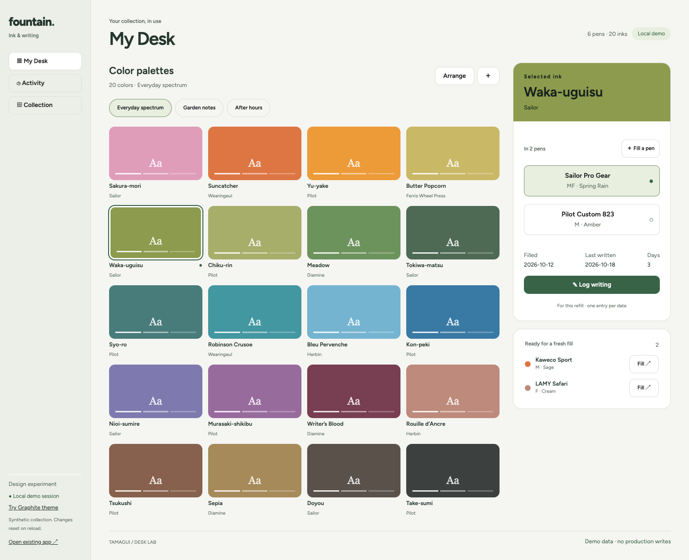
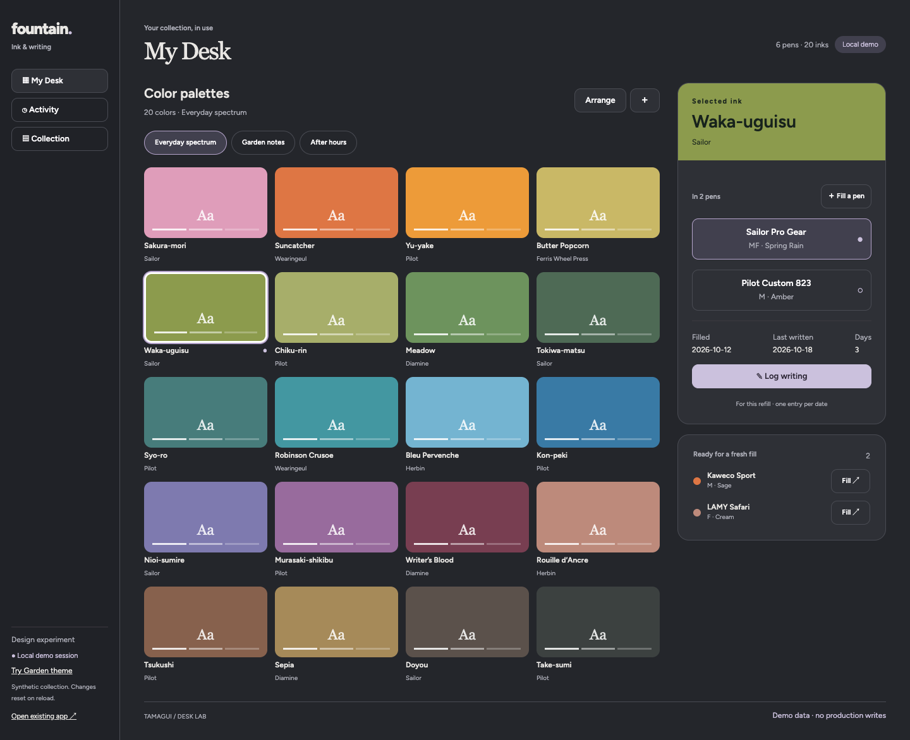
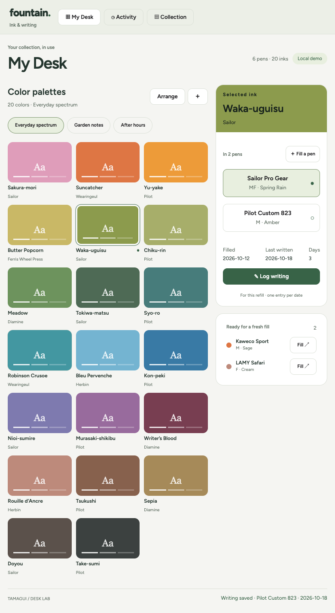
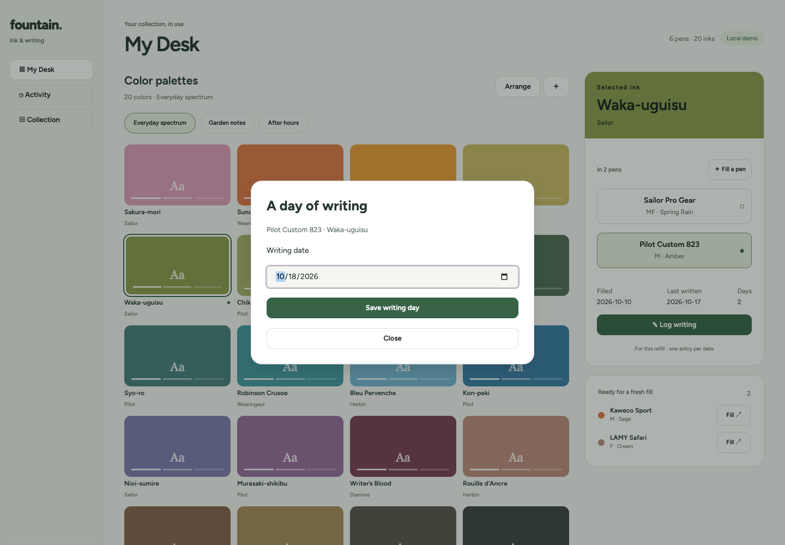

# Tamagui desk experiment

A separate, synthetic vertical slice at `/desk-lab.html`. The existing `/` app and its routes remain intact. This branch is for visual evaluation, not a production migration. No schema, auth, production records, deployment workflow, or service adapter changes.

## Try it

```sh
npm ci
npm run dev
# open http://localhost:5173/desk-lab.html
# alternate: http://localhost:5173/desk-lab.html?theme=graphite
```

- Select an ink, then select one of its pens and log a writing day.
- Waka-uguisu is in two pens. Robinson Crusoe / Bleu Pervenche share a mixed refill.
- Create a named palette; Arrange enables pointer or keyboard sorting (Space, arrows, Space) and omissions. Other palettes retain their own order/membership.
- Fill a pen puts needs-refill pens first. A new refill starts with no writing days; its predecessor and writing history remain in Activity.
- Data is synthetic and session-only. Reload resets it. Collection explicitly explains what remains in the existing app.

## Visual directions

**Garden**: soft sage utility surfaces, Figtree typography, rounded compact controls. The palette is the primary visual element; selected ink, pens, and writing actions stay together. The selected ink heading chooses dark/light text by luminance. Shared Tamagui theme, space, radius, and control-size tokens govern the controls.

**Graphite**: the same component system with charcoal surfaces, subdued lavender control accents, and a serif page heading. This is a comparison direction, not a second implementation. It tests whether a darker, book-like surrounding surface makes the same ink collection more satisfying.

At 1440px the rail, palette and active refill are adjacent. At 780px the rail becomes a top bar and a compact three-column palette stays beside the refill. Narrower windows wrap normally; mobile-specific flows are not a separate scope.






## What existed before this branch

Baseline: `d4fe6c72f3ddc866383cb91a16fd1c5c6f66ca8e` (PR #25), after writing-history PR #24 (`faf05b47b4d75f56325d4e0535c881bbfc826b10`).

React 19, Vite 6, React Router, dnd-kit, Supabase. `src/components/collection/Primitives.tsx` provides custom buttons/icons; `src/index.css` and `src/App.css` implement handwritten CSS tokens and component styles. No MUI, Tailwind, or third-party visual component system was installed. The old design uses Figtree + Bodoni Moda and warm paper/plum tokens.

### Linda's actual prior source

- [gpt-pet/app/package.json](https://github.com/yaylinda/gpt-pet/blob/main/app/package.json): Tamagui 1.79, Expo 49 / React 18, Tamagui Lucide icons and font packages.
- [gpt-pet/app/tamagui.config.ts](https://github.com/yaylinda/gpt-pet/blob/main/app/tamagui.config.ts): shared tokens/themes, dark default, Silkscreen heading/body, bouncy/lazy/quick springs.
- [TaskItem.tsx](https://github.com/yaylinda/gpt-pet/blob/main/app/src/modules/tasks/TaskItem.tsx): actual Button, SizableText and XStack use with rounded geometry, completion feedback and haptics. This is evidence of usage, not a claim that the exact font or native gestures are preferred for this desk.
- Other verified systems: NativeBase in `life-as-booleans-mobile` and `kitchen-sink`; NextUI + Tailwind in `gpt-games`; MUI in `pokemon-team-builder` and `pokopedia`.

Only targeted manifests/config/components were read. No unrelated repositories were cloned.

### History-backed lessons

| Recorded evidence                                                                                          | Design lesson / interpretation                                                                                                  |
| ---------------------------------------------------------------------------------------------------------- | ------------------------------------------------------------------------------------------------------------------------------- |
| `af25601` / PR #21: palette-first desk and inventory under Collection                                      | Recorded hierarchy: colors and current use lead; catalogs are secondary.                                                        |
| `5eef3b2`, `5d88cfe`: clarify palette drafts, group actions, simplify editing                              | Group palette tools and use one shared control vocabulary.                                                                      |
| `5617f80`, `f2d747a`: remove visible ordinals and redundant helper copy                                    | Recorded removal of those elements; avoid decorative numbers and permanent instructions.                                        |
| `1ac1c4b`, `a216494`, `6cf4610`, `cc7b104`: six columns, fluid swatches, separate identity/usage, outlines | These are iterations, not blanket preferences about ratios or borders. Keep recognizable ink identity and coherent proportions. |
| `bc9d803` / PR #23 removes substantial overview machinery                                                  | Inference: a focused desk earns more space than a dashboard of parallel summaries.                                              |
| `faf05b4` / PR #24 adds explicit refill writing days                                                       | Preserve refill identity and derive last-written from recorded days; never infer writing from fill date.                        |
| `d4fe6c7` / PR #25 brings palette and writing controls together                                            | Recorded proximity improvement; keep that relationship while changing visual language.                                          |
| `f7a70b2` / PR #17 clarifies public/owner access                                                           | Existing public/owner boundary stays untouched. The lab is explicitly local demo state.                                         |

No commits explicitly named “revert” were found in the accessible history. Later changes supersede earlier layouts; a briefly tried arrangement is not treated as a lasting preference.

## Implementation and compatibility

Tamagui and `@tamagui/config` are pinned to **3.0.18**, using the current v6 config. npm metadata requires React >=19; React/React DOM are pinned together to 19.3.1 and verified in browser and existing tests. React Native Web 0.21.2 is aliased for web compatibility. The official [Vite guide](https://tamagui.dev/docs/guides/vite) permits a manual web setup; runtime styles are used without extraction. Current v3 bare token references and CSS line-height units are used, not copied from the old 1.x app.

Tamagui Button, Dialog/Portal, Input, Label, typography and stacks form the actual UI. `Action`, `Primary`, `Panel` and text primitives share semantic theme/shape/space tokens. CSS handles the page grid, two viewport layouts, font loading, focus and reduced motion. The experiment is a separate Vite HTML entry, so Tamagui is not imported by the existing app entry.

Skills applied: frontend-design for subject-specific hierarchy and restraint; theme-factory for two coherent custom themes (the user's instruction to choose direction supersedes its theme-choice ceremony); building-components for shared primitives, semantic tokens and keyboard behavior; Impeccable against the provided design context; web-design-guidelines and React best practices for the final source/interaction review. No framework substitutions or added architecture from generic examples.

## Intentional omissions

No live data integration or persistence, sign-in, inventory CRUD, manufacturer details/search, palette rename/delete, writing-day correction/deletion, cleaning flow, or creation of mixed-ink refills. Existing mixed refills are represented correctly. New demo refills are single ink. Existing app provides the production features. Theme switching reloads/reset the demo; it is a visual comparison. No production readiness or hosted preview claim.

## Verification

- `npm test`: 73 passing (including three focused demo model tests).
- `npm run lint`, `npm run build`: pass.
- `npm run test:migration`: 13 passing; `npm run test:deployment`: 8 passing.
- `npm run test:db`: passes against the repository's labeled disposable PostgreSQL container.
- Playwright on actual Chromium: select either pen for one ink, record writing on the chosen refill, repeat date without duplication, select mixed ink, switch named palettes, keyboard reorder, 780px overflow check, both themes, dialog Escape. No page errors.
- Screenshots above are actual rendered app captures, not mockups.

Historical design notes are evidence, not visual requirements. Linda explicitly authorized replacing prior aesthetics/layout choices she no longer likes. Garden and Graphite are new proposals for reaction; neither is presented as a discovered permanent preference.
